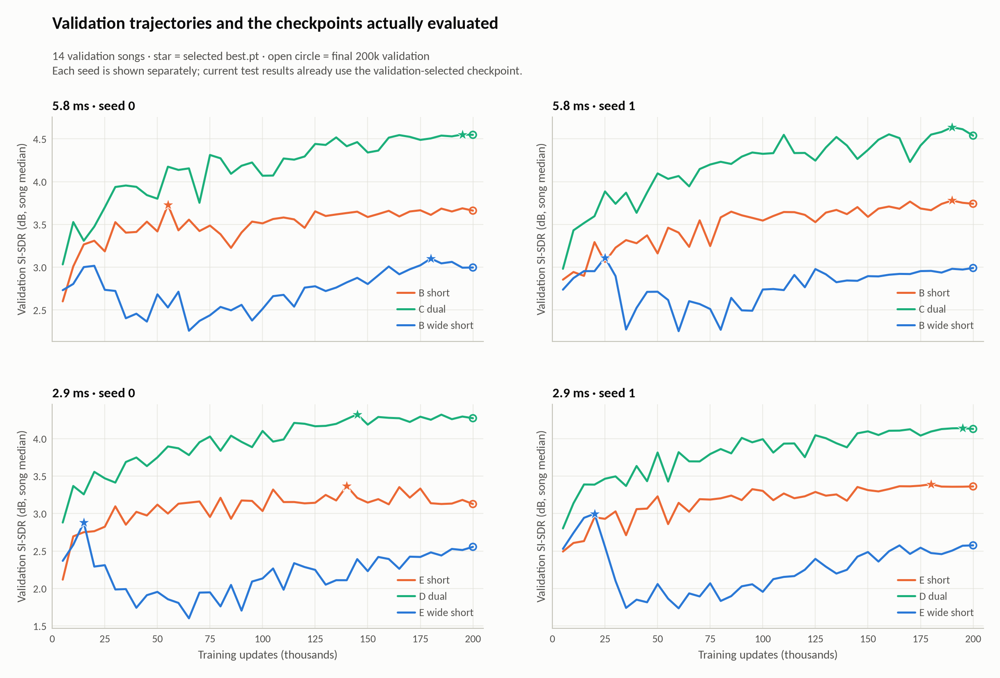
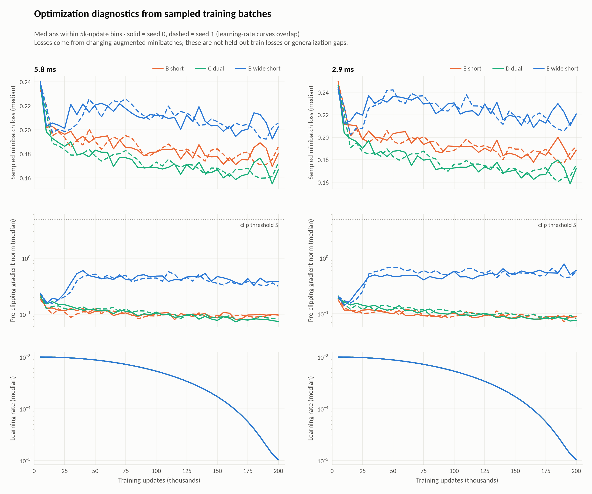

# Training diagnostics for the short-window compute controls

All twelve prescribed runs completed 200,000 updates. Every best.pt checkpoint's config, seed, step and validation score match the maximum in its saved validation log (first maximum on ties). Every existing 50-song test-evaluation sidecar identifies that best.pt and the same step. The 14 validation songs are identical across runs and match the official validation split recorded in dwmss/data.py. No training or model evaluation was rerun.

**The current test comparisons already use validation-selected best.pt checkpoints.** Later validation deterioration therefore does not mean the final 200k checkpoint was mistakenly tested. For older runs the evaluation sidecar establishes checkpoint filename/step agreement, not a retrospective cryptographic proof of the checkpoint bytes used at evaluation time. The source hashes in this report record their state when this diagnostic was produced.

## Validation trajectories

| config | seed | best update | best validation SI-SDR | final validation SI-SDR | best − final | logged batches clipped |
|---|---:|---:|---:|---:|---:|---:|
| B_sym256 | 0 | 55,000 | 3.729 | 3.661 | 0.068 | 0.00% |
| B_sym256 | 1 | 190,000 | 3.780 | 3.741 | 0.038 | 0.00% |
| C_dual | 0 | 195,000 | 4.552 | 4.547 | 0.004 | 0.00% |
| C_dual | 1 | 190,000 | 4.637 | 4.538 | 0.099 | 0.00% |
| E_sym128 | 0 | 140,000 | 3.368 | 3.127 | 0.241 | 0.00% |
| E_sym128 | 1 | 180,000 | 3.392 | 3.362 | 0.030 | 0.00% |
| D_dual_2p9ms | 0 | 145,000 | 4.324 | 4.273 | 0.051 | 0.00% |
| D_dual_2p9ms | 1 | 195,000 | 4.141 | 4.129 | 0.011 | 0.00% |
| B_sym256_compute | 0 | 180,000 | 3.101 | 2.996 | 0.105 | 0.50% |
| B_sym256_compute | 1 | 25,000 | 3.112 | 2.991 | 0.121 | 0.40% |
| E_sym128_compute | 0 | 15,000 | 2.881 | 2.555 | 0.326 | 0.75% |
| E_sym128_compute | 1 | 20,000 | 2.997 | 2.575 | 0.422 | 0.95% |

## What the wider controls show

- **B_sym256_compute**: best validation at 180,000 / 25,000 updates (seeds 0 / 1); best-to-final decline 0.105 / 0.121 dB. Its best validation score is -0.628 / -0.668 dB relative to B_sym256's separately selected best for the same seed.
- **E_sym128_compute**: best validation at 15,000 / 20,000 updates (seeds 0 / 1); best-to-final decline 0.326 / 0.422 dB. Its best validation score is -0.487 / -0.395 dB relative to E_sym128's separately selected best for the same seed.

The trajectories show validation deterioration and sensitivity to the shared training recipe. They do not identify its cause. Overfitting, optimization difficulty, augmentation variability and architecture limitations are competing explanations; these sampled losses cannot distinguish them. In particular, a later validation decline alone cannot explain away the existing test result: the earlier best checkpoint was already selected.

## Descriptive training-batch summaries

Early = updates 1–40,000; late = updates 160,001–200,000. These fixed windows each contain only the minibatches recorded at the configured logging cadence, with changing random crops, gains and remixes. Values summarize logged batches; they are not held-out training-set loss or evidence of a train/validation generalization gap. Gradient norms are returned by clip_grad_norm_ before clipping; a logged batch is counted as clipped only if its norm is strictly above the configured threshold. The clipping fraction is not an estimate of the fraction over all optimizer updates unless the logged batches are representative.

| config | seed | early / late loss median | early / late grad-norm median | early / late logged clipping |
|---|---:|---:|---:|---:|
| B_sym256 | 0 | 0.1992 / 0.1765 | 0.128 / 0.093 | 0.00% / 0.00% |
| B_sym256 | 1 | 0.1988 / 0.1763 | 0.115 / 0.093 | 0.00% / 0.00% |
| C_dual | 0 | 0.1904 / 0.1646 | 0.146 / 0.078 | 0.00% / 0.00% |
| C_dual | 1 | 0.1902 / 0.1637 | 0.135 / 0.083 | 0.00% / 0.00% |
| E_sym128 | 0 | 0.2074 / 0.1864 | 0.118 / 0.087 | 0.00% / 0.00% |
| E_sym128 | 1 | 0.2083 / 0.1856 | 0.119 / 0.085 | 0.00% / 0.00% |
| D_dual_2p9ms | 0 | 0.1960 / 0.1678 | 0.145 / 0.080 | 0.00% / 0.00% |
| D_dual_2p9ms | 1 | 0.1963 / 0.1680 | 0.133 / 0.088 | 0.00% / 0.00% |
| B_sym256_compute | 0 | 0.2104 / 0.2023 | 0.255 / 0.370 | 0.00% / 0.75% |
| B_sym256_compute | 1 | 0.2081 / 0.2017 | 0.240 / 0.352 | 0.00% / 0.25% |
| E_sym128_compute | 0 | 0.2248 / 0.2173 | 0.289 / 0.566 | 0.50% / 1.75% |
| E_sym128_compute | 1 | 0.2202 / 0.2142 | 0.280 / 0.522 | 0.50% / 1.00% |

## Is a bounded follow-up warranted?

Yes. The resulting bounded protocol is recorded in [`EXPERIMENTS.md` section 4](../../EXPERIMENTS.md#bounded-learning-rate-check-at-29-ms) and its [frozen design](../recipe_check/design.md): only the 2.9 ms D dual and E wide-short architectures are compared, with the existing 1e-3 learning rate and one added 3e-4 setting. Weight decay stays 0.01 and all other settings stay fixed. The existing two original-rate seeds per architecture are reused; exactly four fresh 200k-update runs cover the lower rate, with equal candidate/update budgets for D and E. Select one recipe per architecture by the mean of its two seeds' best validation medians, with ties favoring the original rate, before any new test evaluation. There is no broader learning-rate/weight-decay or 5.8 ms search. The test set has already informed this research direction, so its eventual test result remains an exploratory follow-up, not an untouched confirmatory test. This diagnostic script launches no training. The original fixed-recipe comparison remains unchanged.

## Files and reproducibility

- `per_run.csv`: best/final validation, checkpoint checks, clipping fractions and fixed-window summaries.
- `validation_curves.csv`: every saved validation point, with selected-best and final-point flags.
- `sampled_training_batches.csv`: every logged batch with loss, pre-clipping norm, rate and clip flag.
- `training_bins.csv`: descriptive medians in fixed 5k-update bins used by the optimization figure.
- `provenance.json`: SHA-256 of each input log, metadata, DONE marker, best checkpoint, evaluation sidecar, and this script; hashes of generated tables, report and figures.

Reproduce: `python -I scripts/analyze_training_diagnostics.py`.
